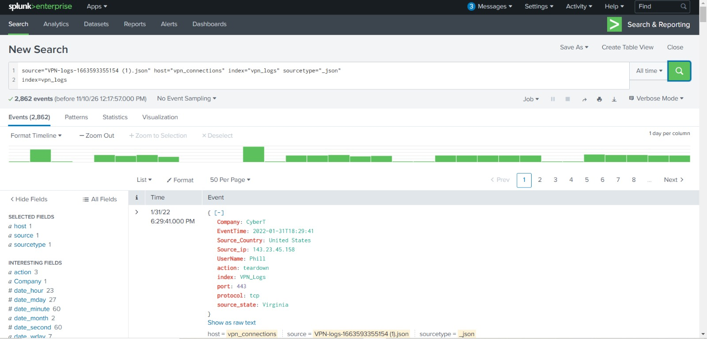
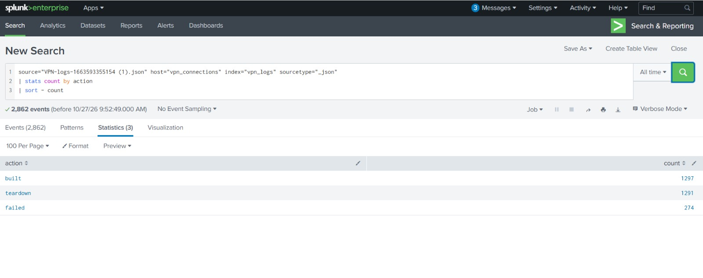
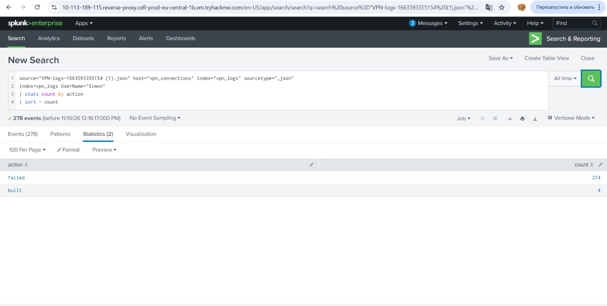
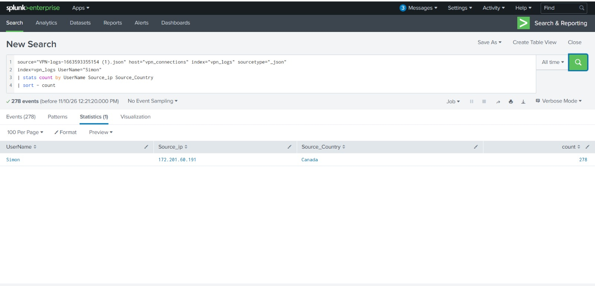
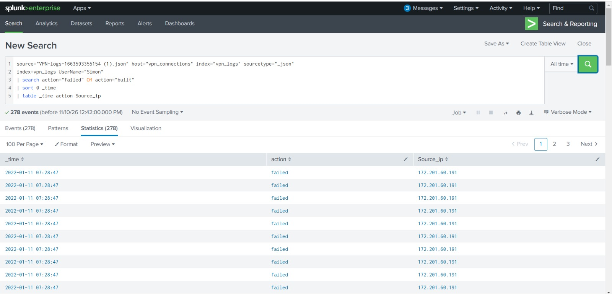
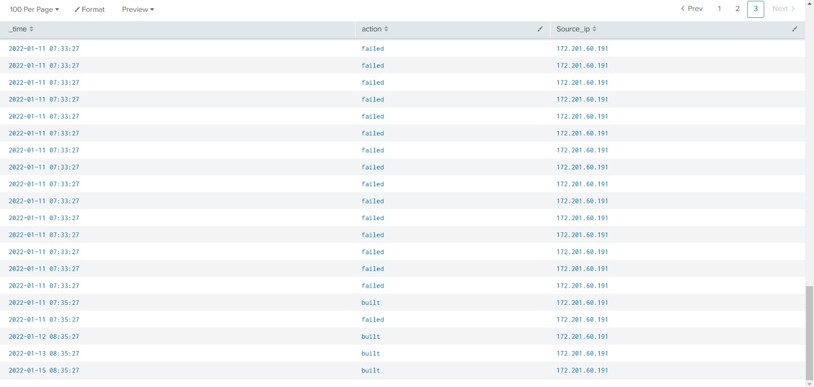

# SOC Analyst L1 — VPN Authentication Investigation

## Project Overview

This project demonstrates a Security Operations Center (SOC) Level 1 investigation of suspicious VPN authentication activity using Splunk and SPL.

The objective was to analyze VPN logs, identify unusual authentication patterns, investigate  suspicious VPN activity, and prepare an incident report for escalation to SOC Level 2.

## Tools & Technologies

- Splunk
- Search Processing Language (SPL)
- VPN authentication logs
- Security event analysis
- Incident reporting

## Investigation Process

### 1. Dataset Overview

- Total events analyzed: 2,862
- Event types: `built`, `teardown`, `failed`

### 2. Event Analysis

| Event type | Count |
|---|---:|
| built | 1,297 |
| teardown | 1,291 |
| failed | 274 |

### 1. Total Events Overview

### 2. Event Type Distribution

### 3. Suspicious Activity Identification

The investigation identified unusual activity associated with one user:

- User: Simon
- Source IP: `172.201.60.191`
- Source country: Canada
- Total events: 278
- Failed events: 274
- Established connection events (`built`): 4

### 3. Simon's VPN Activity

### 4. Source IP Analysis

### 4. Timeline Analysis
A cluster of failed VPN events was observed between approximately 07:28 and 07:33. The first subsequent built event was recorded at approximately 07:35, around two minutes after the last observed failed event.

This pattern raised suspicion of potential brute-force activity followed by an established VPN connection.

### 5. Timeline — Start of Failed Attempts

### 6. Timeline — Failed Attempts and VPN Connection

### 5. Incident Assessment

**Classification:** Potential Brute Force Activity  
**Preliminary Severity:** Medium  
**Status:** Escalated to SOC L2

The available logs do not confirm account compromise or unauthorized access.

Additional investigation is required, including:
- Verification of the user's activity and authorization.
- Validation of the source IP and connection context.
- Review of endpoint telemetry.
- Investigation of activity following the established VPN connection.

The severity assessment is preliminary and based on the available VPN log evidence.

## Investigation Limitations

The investigation was based on the available VPN logs. The following information was not available for independent verification:

- Whether the user authorized the connection.
- Whether the source IP was legitimate or expected.
- Whether the account was compromised.
- What activities occurred on the endpoint after the VPN connection was established.

Further investigation by SOC L2 is required to establish the legitimacy of the activity.

## Key Skills Demonstrated

- Splunk event analysis
- SPL query development
- Authentication log investigation
- IP address analysis
- Timeline reconstruction
- Detection of suspicious activity
- Incident documentation
- SOC L1 to L2 escalation

## Conclusion

This investigation demonstrates how a SOC L1 analyst can identify suspicious authentication patterns, correlate events, assess available evidence, and escalate an incident when further investigation is required.

**Environment:** TryHackMe training lab  
**Project type:** Hands-on SOC investigation

